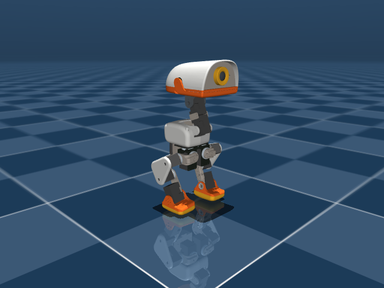

# Micro Duck Forward Roll

基于官方 Microduck RL 的仿真动作拓展项目：使用 **MJlab / MuJoCo Warp + PPO**，让 Micro Duck 从站立开始，用头顶和腿完成前滚翻并重新站稳。

本仓库包含机器人 MJCF、网格、BAM XL330 舵机模型、官方训练任务和独立的前滚翻实验入口。源码基础固定为 [官方提交 273afe0b](https://github.com/pollen-robotics/microduck_rl/commit/273afe0b31c4ab365b9ff806a927b63ac92b5ddd)，依赖由 `uv.lock` 固定；普通 `git clone` 即可获得全部模型，无需子模块。**默认 TensorBoard 本地日志，无需 W&B 账号。**

这是可运行的训练项目，不附带已训练的前滚翻权重。动作是否学成须以云端训练后的评估和视频为准。当前验证情况见 [docs/VALIDATION.md](docs/VALIDATION.md)。



## 云端开始（Linux + NVIDIA）

建议使用 Python 3.12、支持 CUDA 的 NVIDIA 驱动和持久化磁盘。并行环境数受显存和接触复杂度影响，先用 64 个环境验证，再尝试 1024；4096 是后续扩容选项，不保证适合每张卡。

```bash
git clone https://github.com/crzzo0129/micro-duck-forward-roll.git
cd micro-duck-forward-roll
# 云平台未安装 uv 时：
python -m pip install uv
export UV_HTTP_TIMEOUT=600
uv sync --frozen --python 3.12

# 检查 CUDA、模型、61D 观测与 14D 动作配置
uv run python scripts/cloud.py doctor
# 64 环境、5 次 PPO 更新，然后导出并检查 ONNX
uv run python scripts/cloud.py smoke
# 必须 smoke 通过后才开始长训练；默认 10000 次更新
uv run python scripts/cloud.py train --num-envs 1024 --run-name first_roll
```

训练会使用当前目录下的 `logs/rsl_rl/microduck_forward_roll/`。把仓库放在云平台的持久化磁盘；训练结束或关机前保存整个运行目录。检查点、视频、缓存、密钥均不上传 GitHub。

## 日志与续训

```bash
uv run tensorboard --logdir logs/rsl_rl --host 0.0.0.0 --port 6006
# 使用云平台的端口代理打开 TensorBoard

# 指定实际存在的检查点路径；iterations 表示本次追加更新次数
uv run python scripts/cloud.py train --num-envs 1024 --iterations 3000 \
  --checkpoint logs/rsl_rl/microduck_forward_roll/<运行目录>/model_3000.pt \
  --run-name resume_roll
```

可用 `--seed 42` 控制随机种子。直接使用上游命令也可覆盖全部细节：

续训检查点需位于 `logs/rsl_rl/microduck_forward_roll/<运行目录>/` 下；从其他云实例迁移时，将原运行目录放回这里。预览、导出和评估允许加载任意路径。

```bash
uv run train Mjlab-ForwardRoll-Flat-MicroDuck \
  --env.scene.num-envs 1024 --agent.logger tensorboard --agent.max-iterations 10000
```

包装入口会校验源码与依赖指纹，代码变化后要求重新 smoke。Smoke 仅证明环境能运行、PPO 能更新和模型能导出，不能证明技能成功。`--dry-run` 可提前查看将执行的命令。

## 评估、预览与导出

```bash
# 批量从站立开始：完成转动 + 头顶支撑 + 双脚落地 + 稳定保持
uv run python scripts/cloud.py evaluate --checkpoint <model_N.pt> --num-envs 128
# 云端浏览器预览，使用平台代理访问打印出的 Viser 地址
uv run python scripts/cloud.py play --checkpoint <model_N.pt>
# 同时记录视频（云镜像需可用 EGL / OpenGL）
uv run python scripts/cloud.py play --checkpoint <model_N.pt> --video
# 使用官方导出路径，保留观测归一化
uv run python scripts/cloud.py export --checkpoint <model_N.pt> --output outputs/forward_roll.onnx
```

评估输出 `outputs/evaluation_*.json` 和逐环境 CSV。定义、误差限制和奖励设计见 [docs/FORWARD_ROLL.md](docs/FORWARD_ROLL.md)。默认评估保留物理随机化，关闭观测噪声；不是实机验证。视频需人工确认头顶接触位置、前向翻滚和落地姿态。

## 项目拓展

| 文件 | 作用 |
| --- | --- |
| `src/mjlab_microduck/tasks/microduck_forward_roll_env_cfg.py` | 本项目任务，继承官方奖励与课程，分脚接触传感器、站立评估、本地日志 |
| `src/mjlab_microduck/tasks/microduck_roulade_env_cfg.py` | 官方前滚翻训练配方及参数 |
| `src/mjlab_microduck/tasks/mdp.py` | 奖励、旋转累计、头顶接触判定和复位 |
| `scripts/cloud.py` | 云端检查、短测试、训练、续训、预览、导出和评估 |
| `scripts/evaluate_forward_roll.py` | 批量技能评估，支持零动作负对照 |
| `tests/test_forward_roll_cfg.py` | 观测、碰撞、奖励符号与站立评估配置测试 |
| `UPSTREAM.json` / `uv.lock` | 上游来源与依赖版本 |

官方任务也保留：行走 `Mjlab-Velocity-Flat-MicroDuck`、起身 `Mjlab-StandUp-Flat-MicroDuck`、踢球 `Mjlab-BallKick-Flat-MicroDuck`、坐站 `Mjlab-SitStand-Flat-MicroDuck`。`uv run list-envs` 查看全部入口。后续动作优先继承最相近任务，单独登记实验名和成功标准。

## 测试

CPU 模型预览及静态姿态审计：`uv run python scripts/inspect_model.py`。这是 XML PD 控制的模型检查，不是 BAM 策略评估；固定 HOME 指令本身不能保证机器人站稳。

```bash
# 项目新增的、无需 GPU 的流程与评估逻辑测试
uv run python -m unittest discover -s tests -p 'test_cloud_*.py'
# 需要安装训练依赖，但无需 GPU 的配置与奖励测试
uv run --with pytest python -m pytest tests/test_forward_roll_cfg.py tests/test_forward_roll_mdp.py tests/test_forward_roll_cli.py
```

GPU 验证使用 `cloud.py smoke`。运行前务必核对 [验证记录](docs/VALIDATION.md)，其中区分实际完成与尚待云端完成的检查。

## 来源与许可

软件采用 [Apache-2.0](LICENSE)。本仓库保留官方许可；模型文件的许可独立于代码，官方将其标注为 **Creative Commons BY-SA-NC**，未明确版本，商业用途应先核对官方授权。详见 [THIRD_PARTY_NOTICES.md](THIRD_PARTY_NOTICES.md)。本项目当前范围是仿真研究；没有实机执行或实机安全保证。
